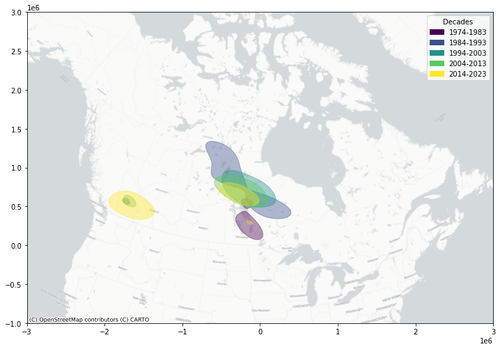
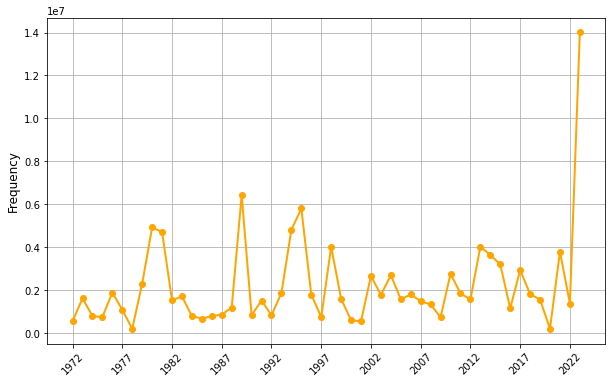
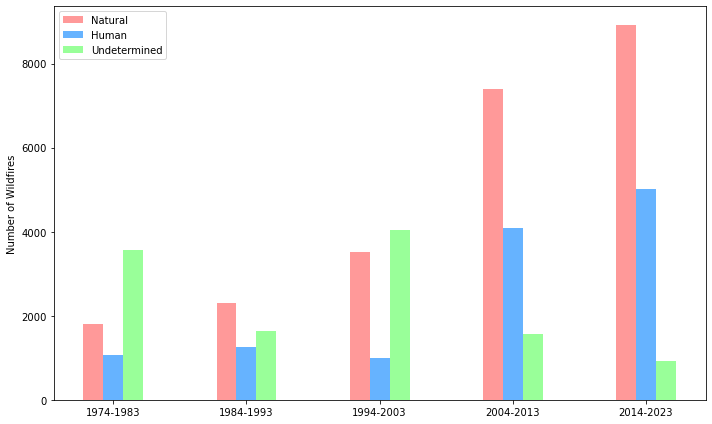
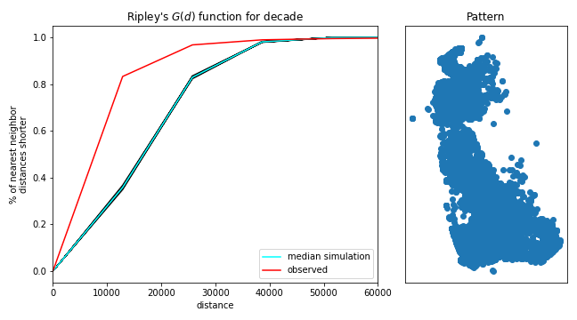
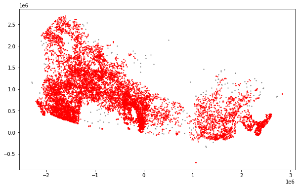

# Wildfire Hotspots in Canada (1972–2023)

Spatial analysis of 50 years of Canadian wildfire data to find **persistent fire-prone zones** – independent of provincial boundaries – and to see how they shift over time.



## Key findings

- **2023 was an extreme outlier**: total burned area was far above any previous year in the record.
- Fire events are **significantly clustered**, not random (Ripley's G, every decade).
- **Central Canada** (Manitoba / Ontario) has been the main fire epicenter for five decades.
- **South-west Canada** has become increasingly fire-prone over the past 30 years, and **Nova Scotia** emerged as a new hotspot in 2023.
- Naturally and human-caused fires have both risen steadily across decades.

| Yearly burned area | Causes over decades |
|---|---|
|  |  |

| Ripley's G (2014–2023) | DBSCAN clusters (2023) |
|---|---|
|  |  |

## Approach

1. **Data prep** – National Burned Area Composite (NBAC) shapefiles converted to GeoParquet, filtered to 1972–2023, already in Canada Lambert Conformal Conic (metres), so no reprojection needed.
2. **Polygons → points** – fire perimeters reduced to centroids to make point-pattern methods tractable at national scale.
3. **Temporal split** – data grouped into five decades (1974–2023) to compare patterns and keep memory use manageable.
4. **Clustering tests** – Ripley's G-function with 999 simulations per decade.
5. **Hotspots** – Kernel Density Estimation per decade; epicenter contours overlaid on one map to show how fire-prone zones move.
6. **Clusters & outliers** – DBSCAN (eps tuned with a k-distance elbow plot) and quantile choropleth mapping of burned area.

The final group report additionally used Global and Local Moran's I to confirm significant clustering of large fires in 2023.

## Tech stack

Python · GeoPandas · Shapely · PySAL (pointpats, mapclassify) · scikit-learn (DBSCAN, NearestNeighbors) · seaborn · Matplotlib · contextily

## Repository structure

```
wildfire_spatial_analysis.ipynb   # main analysis (ESDA, trends, Ripley's G, DBSCAN, KDE)
*.png                             # exported maps and charts
```

## Running it

The data is not included (the raw shapefiles are ~850 MB).

1. Download the NBAC shapefile from the [Canadian Wildland Fire Information System](https://cwfis.cfs.nrcan.gc.ca/datamart). Newer releases include 2024, so filter to `year <= 2023` to reproduce these results.
2. Convert it to GeoParquet (the notebook reads `../data/data.parquet` via `fp_par`; change that path if you store it elsewhere):
   ```python
   import geopandas as gpd
   gdf = gpd.read_file("nbac_1972_2023_20240530.shp")
   gdf[gdf["YEAR"].between(1972, 2023)].rename(columns=str.lower).to_parquet("../data/data.parquet")
   ```
3. Install dependencies and open the notebook:
   ```bash
   pip install -r requirements.txt
   jupyter lab wildfire_spatial_analysis.ipynb
   ```

The original environment was the course Docker image `darribas/gds_py:8.0`.

## Credits

Group project for *Geospatial Data Science* at the IT University of Copenhagen (spring 2025), by **Dariia Moskalova** and **Zisanur Rahman**. We each explored the data in our own notebooks and combined the strongest approaches into the final analysis and report. The data-cleaning step builds on a script by a former group member, Marcus. This repository contains Dariia's notebook.

Data: National Burned Area Composite, Natural Resources Canada – [Open Government Licence – Canada](https://open.canada.ca/en/open-government-licence-canada).
